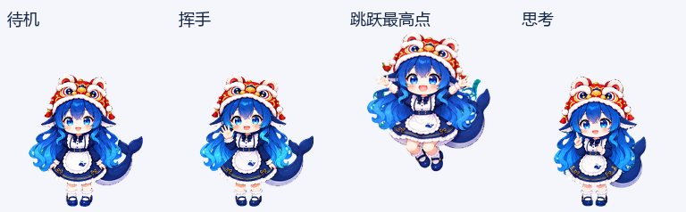

# 狮帽大肥鱼 · DeepSeek Lion Hat Pet

蓝发女仆、鲸鱼尾巴，再戴上一顶红金舞狮头帽的 Q 版动态桌宠。

<p align="center">
  
  
  
</p>

包含 **9 种状态动作 + 16 个看向方向，共 73 帧**。狮帽始终保留，转头由女孩的脸和蓝色眼睛表达，帽上的狮眼保持装饰造型。

[完整动画 GIF](preview.gif) · [视频预览](preview.mp4) · [十六方向循环](look-loop.gif) · [主形象](main.png)

## 使用

桌宠包由根目录的 `pet.json` 与 `spritesheet.png` 两个文件组成，运行桌宠不需要 Python。

按[参考项目公开的自定义 Pets 安装方式](https://github.com/gmskywalker/deepseek-fat-fish-codex-pet#installation--安装)：

1. 点击 **Code → Download ZIP**，解压。
2. 在用户目录下建立 `.codex/pets/deepseek-lion-hat/`。
3. 将 `pet.json` 与 `spritesheet.png` 复制进去。
4. 完全退出并重新打开支持自定义 Pets 的 Codex 客户端，在桌宠设置中选择 **狮帽大肥鱼**。

安装后的目录：

```text
.codex/pets/deepseek-lion-hat/
├── pet.json
└── spritesheet.png
```

## 动作

| 行 | 状态 | 帧数 | 动作 |
|---:|---|---:|---|
| 0 | idle | 6 | 呼吸、眨眼 |
| 1 | running-right | 8 | 向右小跑 |
| 2 | running-left | 8 | 向左小跑 |
| 3 | waving | 4 | 挥手 |
| 4 | jumping | 5 | 下蹲、离地、落地 |
| 5 | failed | 8 | 惊讶、失落、恢复 |
| 6 | waiting | 6 | 期待回应、轻微歪头 |
| 7 | running | 6 | 原地思考与手势 |
| 8 | review | 6 | 查看结果、点头 |
| 9–10 | look | 16 | 顺时针看向十六个方位 |

## 图集与校验

- PNG / RGBA / 透明背景。
- 1536 × 2288 像素，8 列 × 11 行，单格 192 × 208。
- `spriteVersionNumber: 2`。
- 73 个有效单元格，15 个空白单元格保持透明。
- 结构检查与 Pets 预检通过；四个基本方向通过独立盲审。
- 跳跃最高离地 39 px，落地与待机基线差 0 px。
- 部分相邻斜向姿态变化较细，视觉复核后保留；详见 `validation-summary.json`。

SHA-256：

```text
03888904e4b1cd9f569d57e0408ec713baff23c9c5e2284b6a913b81772ca22a
```



[全部动作检查表](contact-sheet.png) · [十六方向检查表](directions.png) · [设计与动作提示词](generation-prompts.md)

## 重新导出预览

辅助脚本仅处理现成图集，不调用模型，也不生成或重画角色：

```bash
python -m pip install -r requirements.txt
python render_previews.py --atlas spritesheet.png --output-dir previews
```

会导出每种状态的 GIF、全部动作 GIF、待机→跳跃→待机 GIF、十六方向 GIF 和四帧图片。视频可另用 FFmpeg 转换：

```bash
ffmpeg -i previews/all-states.gif -movflags +faststart -pix_fmt yuv420p previews/all-states.mp4
```

## 来源与许可

蓝发女仆鲸鱼娘的形象参考 [gmskywalker/deepseek-fat-fish-codex-pet](https://github.com/gmskywalker/deepseek-fat-fish-codex-pet)。本版本基于该形象加入舞狮帽，并使用 AI 重新生成主形象与动画；不将基础角色形象声明为原创。

本项目为非官方同人作品。**辅助脚本、配置及文档使用 MIT；角色、图片与商标相关权利单独见 [ARTWORK-NOTICE.md](ARTWORK-NOTICE.md)。** MIT 不授予基础角色或品牌的商业使用权。
